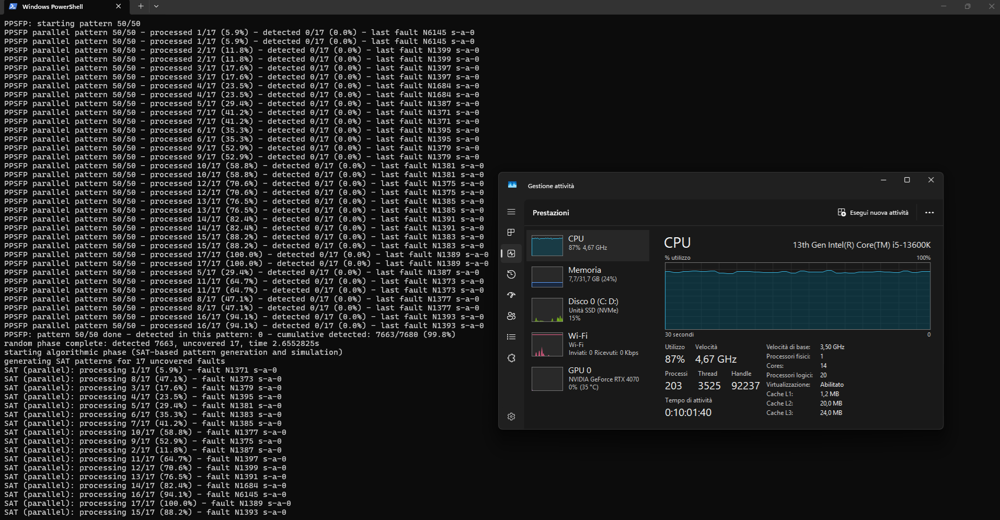

# atpg_rust

This document describes the `atpg_rust` project: execution flow, general logic, module architecture and a detailed explanation of the main functions.

Purpose: generate test vectors that detect stuck‑at faults in ISCAS/Atalanta netlists. The program combines pseudo‑random generation (PPSFP), SAT-based algorithms and exact set-cover minimization to find patterns that cover undetected faults.

Contents
- Overview: concept and purpose
- Execution flow: main steps executed by `main`
- Main modules: file map and responsibilities
- Key data structures: main types and meaning
- Main functions: detailed descriptions and behavior
- Execution examples and runtime options

Note: navigation references to source files are included as links.

Quick overview
The tool reads a netlist (ISCAS89/Atalanta), builds a `Dag` with per-node CNFs, generates random patterns, simulates the good and faulty circuits in parallel (PPSFP) to mark detected faults; for undetected faults it builds SAT formulas (XOR between good and faulty circuit) and attempts to solve them to obtain vectors that cause output differences. In the minimization workflow, the detected faults can be split into easy-detectable, hard-detectable and undetectable sets, and the final exact cover is computed on the selected subset.

Execution
1. Input and parsing
- The input file is read and parsed into a `Netlist` (`parser.rs`).
- Main function: `file_iscas89_atlanta_to_netlist` (`parser.rs`).

2. DAG and CNF construction
- `Dag::from_netlist` converts the `Netlist` into a DAG where each node contains a CNF for its gate (`dag.rs`).
- `rev_adj` and `succ_adj` adjacency lists are precomputed for efficient traversals and fault injection.

3. Pattern generation
- `PatternGenerator` produces `InputPattern` bit-packed random patterns from a seed (`pattern_generator.rs`).
- A single `InputPattern` can encode up to 32 test vectors in parallel: each input name maps to one `u32`, and each bit position represents a separate combination.
- `generate_all_input_combinations(..., Some(true))` returns packed blocks of 32 combinations per `InputPattern`; `generate_all_input_combinations(..., Some(false))` returns one combination per pattern.

4. PPSFP simulation
- `PPSFPSimulator::simulate_patterns_blocks` simulates blocks of packed patterns and checks which faults are detected (`ppsfp.rs`).

5. SAT-based pattern generation
- For undetected faults the solver constructs a test formula: CNF(good cone) + CNF(faulty cone) + BD clauses.
- CNF minimization is optional; the solver backend can be internal (2-SAT + extension) or `varisat`.

6. Minimal input-set workflow
- `minimal` computes an exact minimal cover of input patterns for the fault set selected by the current workflow.
- `minfull` mirrors the full main workflow, but it keeps the fault categories explicit: easy-detectable faults (random phase), hard-detectable faults (found only after SAT), and undetectable faults (still uncovered after SAT).
- If no hard-detectable faults remain, `minfull` falls back to minimizing over the easy-detectable faults so that the minimization result is never empty when the random phase already covers everything.
- The minimizer works on packed candidates and evaluates them by bit position, so one `InputPattern` can contribute multiple row candidates.

7. Post-processing
- SAT solutions are converted to `InputPattern` and re-simulated for confirmation.
- Final patterns are saved using utilities in `util.rs`.

Files and responsibilities
- `main.rs`: orchestration and argument parsing.
- `parser.rs`: parse ISCAS/Verilog -> `Netlist`.
- `netlist.rs`: gate and netlist data types.
- `dag.rs`: DAG construction, boolean evaluator, CNF conversion, fault enumeration.
- `pattern_generator.rs`: `InputPattern` and `PatternGenerator`.
- `ppsfp.rs`: PPSFP simulator.
- `sat.rs`: SAT orchestration and wrapper for `varisat`/builtin solver.
- `simple_solver.rs`: internal DPLL/unit-propagation solver.
- `cnf.rs`: CNF utilities and gate→CNF conversion.
- `cnf_minimizer*.rs`: CNF minimization modules.
- `options.rs`: runtime options.
- `util.rs`: helper functions for printing, parsing args, saving outputs.

Main workflow additions
- `minimal_input_set.rs`: exact set-cover search over candidate input rows, including packed pattern candidates and per-bit-position evaluation.
- `main.rs`: now includes `minimal_combination_full_workflow`, a CLI helper that runs random + SAT + split classification + minimal cover in one pass.

Data types
- `GateType`: enum representing gates (AND, OR, XOR, NAND, NOR, XNOR, BUF, NOT).
- `Gate`: `name`, `gate_type`, `outputs`, `inputs`.
- `Netlist`: `inputs`, `outputs`, `gates`.
- `Dag`/`DagNode`: node-level CNF and adjacency lists.
- `Fault`: `wire`, `sa1`, `site`.
- `InputPattern`: `HashMap<String,u32>` where each `u32` packs up to 32 patterns; bit position `0` is the LSB row, bit position `31` is the MSB row.

Key behaviors
- `Dag::generate_fault_list` enumerates faults using Atalanta-like rules (producer-level vs site-specific), considering fanout and final outputs.
- `PPSFPSimulator` performs bit-parallel simulation and uses `simulate_fault` to force a wire to `0` or `!0u32` to check detection across 32 packed vectors.
- `simulate_single_input` evaluates exactly one packed row of an `InputPattern` at a chosen bit position, which is used by the minimizer to score a candidate row.
- `sat::sat_solving` builds test formulas and calls the chosen SAT backend; it can minimize the CNF and prefer prioritized variables from the influence cone.

SAT strategies
- The internal approach extracts the 2-SAT portion (solvable in linear time) and enumerates assignments up to a limit, then extends them to the remaining 3-SAT clauses via DPLL/unit-propagation.
- `varisat` can be used as an external backend by converting CNF to DIMACS and invoking the solver for better performance.

Minimization
- Built-in minimizer tries to remove literals/clauses while preserving satisfiability of the test goal.
- Optional Espresso integration exports the cover to Espresso and maps the result back to CNF; it is disabled by default due to external I/O overhead.

Verification
- SAT models are converted into `InputPattern` and re-simulated; boolean single-bit evaluation is used for diagnostics when a full boolean assignment is available.

Saving outputs
- `save_patterns_to_test_inputs` and `save_patterns_to_file` (in `util.rs`) write final patterns in formats compatible with Atalanta, and optionally save undetected fault lists.

Examples
- Build and run sample benchmark:

```powershell
cd atpg_rust
cargo run -- 432
```

Options include `mode` (`rand` / `alg` / `both`), `sat_backend` (`varisat` or `builtin`), and `minimizer` (`espresso` or `builtin`).

The `minimal` and `minfull` helpers are available through the special CLI command dispatcher in `main.rs`.

**Runtime positional options (non-special CLI)**

- The program accepts positional (non-special) CLI arguments when you run the main workflow. These are parsed in order and are useful to run the tool on a specific circuit, target a wire, set the seed, choose modes and runtime options.
- Positional arguments (1-based indexes):
	1. `n` (int) — circuit index or an integer used to resolve a benchmark filename. Defaults to `NET_N_DEFAULT`.
	2. `fault_wire` (string | optional) — a specific wire name to restrict fault generation (or omit to use all faults).
	3. `sa1` (bool) — stuck‑at value: `1` for s-a-1, `0` for s-a-0. NOTE: boolean values must be passed as `0` or `1` (the helper accepts only integers 0/1).
	4. `seed` (int) — RNG seed for pseudo-random pattern generation.
	5. `mode` (string) — run mode: accepts `rand`/`random`/`r` (random-only), `alg`/`algorithm`/`a` (algorithmic-only / SAT), `both`/`combined`/`all` (both phases). Case-insensitive.
	6. `enable_sat` (bool: `0`|`1`) — enable SAT phase (default `1`).
	7. `optimize` (bool: `0`|`1`) — enable CNF minimization/optimization (default matches MINIMIZER_BACKEND presence).
	8. `minimizer` (string) — minimizer backend: use `espresso`, `builtin`, or `none` to disable minimization. The string comparison is case-insensitive (`none` disables minimization).
	9. `sat_backend` (string) — SAT backend: typically `varisat` or `builtin` (case-insensitive string accepted).

- Examples (many variants / casings):

```powershell
# minimal invocation: run circuit determined by index 432 (defaults for other args)
cargo run -- 432

# specify wire, sa1=1, custom seed, random-only mode
cargo run -- 432 N123 1 762000 rand
cargo run -- 432 N123 1 762000 RAND      # casing doesn't matter for mode
cargo run -- 432 N123 1 762000 r         # short alias

# full set of runtime options: enable SAT, enable optimization, builtin minimizer, varisat SAT backend
cargo run -- 432 N123 1 762000 both 1 1 builtin varisat

# disable SAT (set 0), still run random phase only
cargo run -- 432 None 0 762000 rand 0 0 none builtin

# use minimizer 'none' (case-insensitive)
cargo run -- 432 N123 1 762000 both 1 1 none varisat

# bench full — note: `bench full` shifts positional indices (see main.rs):
#  usage pattern: cargo run -- bench full <n> <fault_wire> <sa1> <seed> <mode> <enable_sat> <optimize> <minimizer> <sat_backend>
cargo run -- bench full 432 N123 1 762000 rand 1 1 none varisat

# bench ppsfp (micro-benchmark), many alias examples
cargo run -- bench ppsfp
cargo run -- bench pp
cargo run -- bench p
```

**Special CLI Commands**

- **File:** `main.rs` contains helper functions for the special CLI commands (see [main.rs](main.rs)).

- **Command matching:** All primary commands and the `bench` subcommands are case-insensitive and accept several short aliases. The program lowercases the provided argument and compares it against the known variants, so any combination of upper/lower case will work.

- **Supported command names and aliases (exact list implemented in `main.rs`):**
	- **compare:** `compare`, `comp`, `c` (examples: `compare`, `Comp`, `C`)
	- **snapshot_iscas89:** `snapshot_iscas89`, `snap`, `s` (examples: `snapshot_iscas89`, `Snap`, `s`)
	- **unroll_iscas89:** `unroll_iscas89`, `unroll`, `u` (examples: `unroll_iscas89 3`, `unroll 3`, `U 3`)
	- **bench:** `bench`, `benchmark`, `b` (examples: `bench`, `Benchmark`, `b`)
		- `bench` subcommands (case-insensitive): `ppsfp`, `pp`, `p` (runs PPSFP micro-benchmark)
		- `bench` subcommands (case-insensitive): `full`, `f` (runs full benchmark suite)
	- **minimal:** `minimal`, `min`, `m` (examples: `minimal 432`, `min 432`, `M 432`)
	  - **minfull:** `minfull`, `minwf`, `mf` (runs random + SAT + split classification + minimal cover with the full workflow semantics)

- **Usage examples (showing aliases and casing variants):**

```powershell
# primary commands (three variants shown)
cargo run -- compare
cargo run -- comp
cargo run -- C

# snapshot / conversion
cargo run -- snapshot_iscas89
cargo run -- snap
cargo run -- S

# unroll (k = 3 frames)
cargo run -- unroll_iscas89 3
cargo run -- unroll 3
cargo run -- u 3

# bench: run PPSFP micro-benchmark (many alias/casing examples)
cargo run -- bench ppsfp
cargo run -- bench pp
cargo run -- bench p
cargo run -- b ppsfp
cargo run -- B P

# bench: run full suite (aliases)
cargo run -- bench full
cargo run -- bench f
cargo run -- b f

# minimal (compute exact minimal pattern set for circuit 432)
cargo run -- minimal 432
cargo run -- min 432
cargo run -- m 432

# full-workflow minimal cover with easy/hard/undetectable split
cargo run -- minfull 432
cargo run -- minwf 432
cargo run -- mf 432
```

For more details about each command's behavior and arguments, see the helper functions in [main.rs](main.rs).

Snapshot conversion: sequential -> combinational
------------------------------------------------
The project includes a helper function `snapshot_iscas89_folder` (see [util.rs](util.rs)) that converts sequential ISCAS/Verilog descriptions into combinational ATLANTA/bench snapshots. This conversion is used to run combinational ATPG on designs that contain flip-flops by treating flip-flop outputs as primary inputs representing the snapshot (state) of the circuit.

Detailed logic of the conversion performed by `snapshot_iscas89_folder`:
- Input/Output: it scans an `input_dir` for Verilog files (`*.v`) and writes bench files into `output_dir` with the suffix `_to_iscas89_atlanta.bench`.
- DFF detection: each Verilog file is read line-by-line to find DFF instantiations. The routine detects both named-port styles (e.g. `.Q(net)`) and positional styles (e.g. `dff DFF_0(CK,Q,D);`). For named ports it looks for `.q`/`.Q(` occurrences and extracts the net inside parentheses. For positional forms it parses the parenthesized argument list and takes the second field as the Q output when present.
- Snapshot inputs: every detected DFF Q net is added to the netlist's primary inputs (if not already present). The clock net `CK` (case-insensitive) is removed from primary inputs if present.
- Parsing safety: parsing of the Verilog into an internal `Netlist` is attempted via the existing parser; parser panics are caught and the file is skipped with a warning if parsing fails.
- Floating outputs removal: any primary outputs that are not driven by any gate are removed to avoid floating outputs in the generated bench (Atalanta treats floating outputs as errors). A warning is emitted listing removed outputs if any.
- Reachability pruning: the converter computes the set of nets required to drive the remaining primary outputs and prunes gates that do not contribute to those outputs. This is done iteratively: starting from the outputs, any gate producing a required net causes its inputs to be marked as required, repeating until a fixpoint. Gates whose outputs are not in the required set are removed; a warning is issued when pruning occurs.
- Input pruning: after reachability pruning, primary inputs that are no longer used are removed from the inputs list; a warning is printed for removed inputs.
- Input/Output consistency: nets declared both as `INPUT` and `OUTPUT` are resolved by removing them from the input list to avoid duplicate declarations in the bench file.
- Bench file emission: the resulting combinational netlist is written as a bench file where each input is emitted as `INPUT(name)`, each output as `OUTPUT(name)`, and each gate as `out = GATETYPE(in1, in2, ...)` (or `out = GATETYPE` for zero-input primitives). The output filename follows `<stem>_to_iscas89_atlanta.bench` where `stem` is the original Verilog filename stem.

Notes and behavior:
- The snapshot approach is conservative: by making DFF Q outputs primary inputs, the function produces a single-timeframe (combinational) view of the circuit that captures arbitrary flip-flop states. This is suitable for combinational ATPG and for comparing results with tools that expect combinational bench inputs.
- The converter attempts to produce well‑formed bench files compatible with Atalanta by removing floating outputs and unreachable logic; when the parser or conversion encounters unexpected constructs it skips files and prints informative warnings.
- The function is implemented in [util.rs](util.rs) and is intended for bulk conversion of a folder of Verilog files; it is not a full-featured Verilog frontend and assumes common DFF instantiation idioms.

Time-frame expansion (unroll) and why it's not used
--------------------------------------------------
In addition to the snapshot conversion, the codebase contains a time-frame expansion utility `unroll_iscas89_folder` (see [util.rs](util.rs)). This routine attempts to convert sequential Verilog designs into an explicitly unrolled combinational network spanning `k_frames` temporal frames. Its main behavior is:
- Duplicate primary inputs per frame: each original primary input `name` becomes `name_t{frame}` for each frame.
- Model flip-flops as inputs at frame 0: flip-flop Q outputs are represented as additional primary inputs `Q_t0` to model initial state.
- Final outputs selection: outputs in the unrolled bench are taken from the nets corresponding to frame `k_frames` (suffix `_t{k_frames}`), representing the circuit state after `k_frames` time steps.

Why `unroll_iscas89_folder` is not used by default:
- Fragility and parser limits: the unrolling function is more sensitive to Verilog variations and corner cases; the project does not rely on a full Verilog frontend, so some files may unroll incorrectly or trigger parsing edge cases.
- Increased size and complexity: unrolling multiplies the netlist size by `k_frames`, leading to much larger bench files and much heavier ATPG/SAT problems. This often makes the approach impractical for medium-to-large designs.
- Floating outputs and compatibility: unrolling can produce nets that are not driven or introduce additional floating outputs that break downstream tools (Atalanta requires well-formed combinational benches). Extra pruning is required, and the code contains comments noting it "does not always work".
- Floating outputs and compatibility: unrolling can produce nets that are not driven or introduce additional floating outputs. Crucially, Atalanta does not accept bench files that contain floating outputs; it requires all primary outputs to be driven. Because of this limitation, unrolling often produces bench files that Atalanta will reject unless extensive pruning and manual fixes are applied. This compatibility constraint is a primary reason the unrolling approach is not used by default.
- Scope and intent: the project's primary approach for handling sequential circuits is the conservative snapshot method (treating DFF Q outputs as primary inputs) which provides a compact single-frame view suitable for combinational ATPG. That method is simpler, more robust for bulk conversion, and sufficient for the comparisons performed in the repository.

For these reasons `unroll_iscas89_folder` is present as an available utility but is not the recommended or default conversion path; it remains in `util.rs` for experimentation or for targeted use on small, well-formed Verilog files where temporal expansion is explicitly desired.

## Benchmark results
- Prefixes:
  - "c": iscas85.
  - "s": iscas89 (snapshot converted).
- Faults categories:
  - Undetectable fault (in the table: "Und. faults"): the sat solving process was completed and there's not a input combination to detect the fault.
  - Aborted fault (in the table "Ab. faults"): the sat solving process was stopped due to the duration limit (2 hours) no input combination was found but there is no certainty that they don't exist.


| File | Total (s) | Parse (s) | DAG (s) | Rand (s) | Rand detected | SAT (s) | SAT detected | Total detected | Faults | Und. faults | Ab. Faults | Coverage (%) |
|---|---:|---:|---:|---:|---:|---:|---:|---:|---:|---:|---:|---:|
| c17_to_iscas89_atlanta.bench | 0.002 | 0.000 | 0.000 | 0.002 | 16/16 | 0.000 | 0/16 | 16/16 | 16 | 0 | 0 | 100.00 |
| c432_to_iscas89_atlanta.bench | 0.091 | 0.001 | 0.001 | 0.053 | 469/472 | 0.037 | 0/472 | 469/472 | 472 | 3 | 0 | 99.36 |
| c499_to_iscas89_atlanta.bench | 0.184 | 0.001 | 0.001 | 0.083 | 683/684 | 0.100 | 1/684 | 684/684 | 684 | 0 | 0 | 100.00 |
| c880_to_iscas89_atlanta.bench | 0.322 | 0.001 | 0.001 | 0.162 | 938/949 | 0.158 | 11/949 | 949/949 | 949 | 0 | 0 | 100.00 |
| c1355_to_iscas89_atlanta.bench | 0.764 | 0.001 | 0.001 | 0.411 | 1551/1564 | 0.350 | 13/1564 | 1564/1564 | 1564 | 0 | 0 | 100.00 |
| c1908_to_iscas89_atlanta.bench | 2.964 | 0.002 | 0.002 | 1.086 | 1795/1859 | 1.874 | 62/1859 | 1857/1859 | 1859 | 2 | 0 | 99.89 |
| c2670_to_iscas89_atlanta.bench | 33.420 | 0.003 | 0.003 | 3.631 | 2247/2629 | 29.783 | 296/2629 | 2543/2629 | 2629 | 86 | 0 | 96.73 |
| c3540_to_iscas89_atlanta.bench | 95.876 | 0.003 | 0.004 | 2.298 | 3312/3402 | 93.571 | 13/3402 | 3325/3402 | 3402 | 77 | 0 | 97.74 |
| c5315_to_iscas89_atlanta.bench | 9.972 | 0.005 | 0.006 | 2.197 | 5148/5160 | 7.765 | 2/5160 | 5150/5160 | 5160 | 10 | 0 | 99.81 |
| c7552_to_iscas89_atlanta.bench | 84.522 | 0.015 | 0.008 | 12.872 | 6922/7316 | 71.626 | 312/7316 | 7234/7316 | 7316 | 82 | 0 | 98.88 |
| s27_to_iscas89_atlanta.bench | 0.002 | 0.000 | 0.000 | 0.002 | 13/13 | 0.000 | 0/13 | 13/13 | 13 | 0 | 0 | 100.00 |
| s382_to_iscas89_atlanta.bench | 0.002 | 0.000 | 0.000 | 0.002 | 28/28 | 0.000 | 0/28 | 28/28 | 28 | 0 | 0 | 100.00 |
| s420_to_iscas89_atlanta.bench | 0.118 | 0.000 | 0.000 | 0.065 | 131/201 | 0.052 | 70/201 | 201/201 | 201 | 0 | 0 | 100.00 |
| s641_to_iscas89_atlanta.bench | 0.178 | 0.001 | 0.001 | 0.098 | 527/550 | 0.079 | 23/550 | 550/550 | 550 | 0 | 0 | 100.00 |
| s713_to_iscas89_atlanta.bench | 0.365 | 0.001 | 0.001 | 0.212 | 504/546 | 0.152 | 37/546 | 541/546 | 546 | 5 | 0 | 99.08 |
| s1238_to_iscas89_atlanta.bench | 1.570 | 0.001 | 0.001 | 0.705 | 897/1038 | 0.863 | 126/1038 | 1023/1038 | 1038 | 15 | 0 | 98.55 |
| s1423_to_iscas89_atlanta.bench | 0.431 | 0.000 | 0.000 | 0.258 | 165/316 | 0.173 | 44/316 | 209/316 | 316 | 107 | 0 | 66.14 |
| s1488_to_iscas89_atlanta.bench | 0.281 | 0.001 | 0.001 | 0.227 | 924/928 | 0.053 | 4/928 | 928/928 | 928 | 0 | 0 | 100.00 |
| s5378_to_iscas89_atlanta.bench | 8.959 | 0.004 | 0.004 | 4.143 | 4244/4355 | 4.807 | 52/4355 | 4296/4355 | 4355 | 59 | 0 | 98.65 |
| s9234_to_iscas89_atlanta.bench | 0.408 | 0.001 | 0.001 | 0.227 | 1128/1151 | 0.178 | 0/1151 | 1128/1151 | 1151 | 23 | 0 | 98.00 |
| s13207_to_iscas89_atlanta.bench | 169.550 | 0.005 | 0.005 | 34.915 | 3894/5327 | 134.625 | 1396/5327 | 5290/5327 | 5327 | 37 | 0 | 99.31 |
| s15850_to_iscas89_atlanta.bench | 26.658 | 0.015 | 0.005 | 5.895 | 4676/4839 | 20.744 | 24/4839 | 4700/4839 | 4839 | 139 | 0 | 97.13 |
| s35932_to_iscas89_atlanta.bench | 0.592 | 0.008 | 0.002 | 0.581 | 2508/2508 | 0.000 | 0/2508 | 2508/2508 | 2508 | 0 | 0 | 100.00 |
| s38417_to_iscas89_atlanta.bench | 3.464 | 0.006 | 0.001 | 0.801 | 1027/1168 | 2.655 | 126/1168 | 1153/1168 | 1168 | 15 | 0 | 98.72 |
| s38584_to_iscas89_atlanta.bench | 551.259 | 0.013 | 0.009 | 52.480 | 5649/7397 | 498.756 | 823/7397 | 6472/7397 | 7397 | 925 | 0 | 87.49 |
| c6288_to_iscas89_atlanta.bench | 2.627 | 0.005 | 0.006 | 2.617 | 7663/7680 | 0.000 | 0/7680 | 7663/7680 | 7680 | 0 | 17 | 99.78 |

Note on the last benchmark file file
--------------------------------------------------
- **Observation:** the last file remaining to test is the circuit `c6288`: the pseudorandom phase detects 7663 faults, but the remaining 17 faults trigger a combinatorial explosion during the SAT phase, making solving impractical (sat solver runtime exceeds 10 hours). Below is an example screenshot from the solver run:


